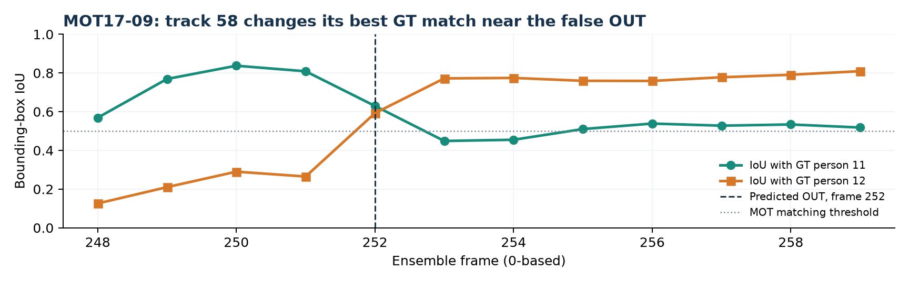

# Final Report: Video-Based People Counting (Project p29)

**Computer Vision course project**

**Repository:** <https://github.com/NikolayTaran/cv_people_counting>

**Report date:** 1 November 2026

## 1. Introduction / Brief Overview

The objective is to count people crossing a virtual line in both directions
(IN and OUT) in video, including scenes with occlusion, dense crowds, and
different camera viewpoints. The research question is: **How reliably does a
YOLO11 detector, ByteTrack-style multi-object tracker, and directional line
counter transfer across these conditions, and do pedestrian fine-tuning or a
two-detector ensemble improve counting enough to justify their tracking and
computational costs?**

We implemented an end-to-end pipeline: MOT17/MOT20 data loading and YOLO-format
export; COCO-pretrained or pedestrian-fine-tuned YOLO11 person detection;
custom two-stage ByteTrack association using an eight-dimensional Kalman
filter, IoU cost, and Hungarian matching; bottom-centre track points with line
hysteresis and cooldown; and evaluation of counting and tracking. MOT17-11 also
uses camera-motion compensation. A second approach fuses detections from the
fine-tuned and COCO-pretrained YOLO11s models before the same tracker and
counter. The selected three-epoch checkpoint and both inference modes are
available in the repository.

Detector training used the first 80% of MOT17-04 and MOT17-05: 1,510 images
and 39,144 pedestrian boxes. The remaining 377 images and 11,397 boxes from
those same two cameras formed chronological validation. Four additional
sequences, MOT17-02, MOT20-01, MOT17-09, and MOT17-11, supplied 2,454 frames
for configuration comparison. No frames from these four videos entered
detector training. However, their scores influenced the choice of the
three-epoch model and the ensemble.

**All four-camera results in this report are preliminary post-selection
comparisons, not an unbiased final test.**

## 2. Final Results

For each sequence, counting accuracy is
`CA = max(0, 1 - (|Pred_IN - GT_IN| + |Pred_OUT - GT_OUT|) / max(GT_IN + GT_OUT, 1))`.
Curve MAE is the mean absolute error of cumulative IN/OUT counts at 50-frame
checkpoints. Ground-truth counting events are generated from annotated tracks
with the same line geometry as predicted events. MOTA and IDF1 evaluate
tracking. All aggregate metrics below are unweighted means over the same four
comparison sequences; arrows indicate the preferred direction.

| Tested approach | Mean CA ↑ | Curve MAE ↓ | MOTA ↑ | IDF1 ↑ |
|---|---:|---:|---:|---:|
| COCO YOLO11n | 0.5501 | 2.5913 | **0.4361** | 0.4446 |
| COCO YOLO11s | 0.6222 | 1.9747 | 0.4352 | **0.4671** |
| YOLO11s fine-tuned, 3 epochs | 0.6548 | **1.7021** | 0.4113 | 0.4324 |
| YOLO11s fine-tuned, 20 epochs | 0.5794 | 2.1542 | 0.4080 | 0.4277 |
| Two-detector ensemble | **0.6654** | 1.7858 | 0.3989 | 0.4261 |

Scene-level CA shows why the aggregate ranking alone is insufficient:

| Sequence and condition | COCO 11n | COCO 11s | 3 epochs | 20 epochs | Ensemble |
|---|---:|---:|---:|---:|---:|
| MOT17-02, occlusion | 0.4762 | 0.5238 | 0.5238 | 0.3810 | **0.5714** |
| MOT20-01, dense crowd | 0.3462 | 0.4231 | 0.3462 | **0.6154** | 0.5385 |
| MOT17-09, low-angle view | 0.7692 | 0.8462 | **0.9231** | 0.5385 | 0.7692 |
| MOT17-11, moving view | 0.6087 | 0.6957 | **0.8261** | 0.7826 | 0.7826 |

For the two approaches directly compared in matched runs, directional totals
were as follows. These totals expose errors that a single average can hide.

| Sequence | GT IN/OUT | 3-epoch IN/OUT | Ensemble IN/OUT |
|---|---:|---:|---:|
| MOT17-02 | 16 / 5 | 10 / 1 | 10 / 2 |
| MOT20-01 | 21 / 5 | 7 / 2 | 10 / 6 |
| MOT17-09 | 10 / 3 | 9 / 3 | 8 / 4 |
| MOT17-11 | 11 / 12 | 9 / 10 | 7 / 11 |

## 3. Comparison

The three-epoch YOLO11s raises observed mean CA from 0.5501 for COCO YOLO11n
to 0.6548 (+0.1047), while reducing Curve MAE to 1.7021. COCO YOLO11s is a
stronger untrained detector than YOLO11n on these videos (CA 0.6222 versus
0.5501) and has the highest mean IDF1, 0.4671. The three-epoch checkpoint is
best among single detectors for mean CA and for the two camera-view sequences,
MOT17-09 and MOT17-11.

Longer fine-tuning is condition-dependent. The 20-epoch checkpoint improves
validation mAP50-95 from 0.6781 to 0.7246 and achieves the best MOT20-01 CA,
0.6154, but its mean comparison CA is only 0.5794. On MOT17-09, CA falls from
0.9231 (three epochs) to 0.5385 (20 epochs). The two-camera training and
validation distribution therefore does not predict the ranking on the other
camera viewpoints. The result is consistent with view specialization, though
these experiments do not isolate the exact mechanism.

The ensemble adds 0.0106 mean CA over the three-epoch single detector. It
improves MOT20-01 by 0.1923 CA and MOT17-02 by 0.0476, but loses 0.1539 on
MOT17-09 and 0.0435 on MOT17-11. Across the four videos, the ensemble reduces
tracker misses from 26,801 to 23,491 and increases false positives from 5,812
to 9,076. Its mean MOTA falls from 0.4113 to 0.3989, and IDF1 falls from
0.4324 to 0.4261. Its Curve MAE also rises from 1.7021 to 1.7858. Thus a
small improvement in final IN/OUT totals does not imply better track quality
or more accurate counts throughout each video.

## 4. Runtime / Computational Measurements

The matched single-detector and ensemble runs processed the same 2,454 frames
on an NVIDIA GeForce RTX 4060 Laptop GPU with video rendering disabled. The
per-sequence wall times below are recorded in the run metadata, rather than
estimated from rounded per-sequence FPS.

| Sequence | Frames | Single detector, s | Ensemble, s | Single FPS | Ensemble FPS |
|---|---:|---:|---:|---:|---:|
| MOT17-02 | 600 | 22.83 | 27.47 | 26.28 | 21.84 |
| MOT20-01 | 429 | 16.40 | 20.21 | 26.16 | 21.23 |
| MOT17-09 | 525 | 14.53 | 23.80 | 36.14 | 22.06 |
| MOT17-11 | 900 | 71.66 | 93.14 | 12.56 | 9.66 |
| **Total / effective rate** | **2,454** | **125.42** | **164.62** | **19.57** | **14.91** |

The ensemble adds 39.20 seconds, approximately 31% of the single-detector
time, for a 0.0106 gain in mean CA. The effective rate is about 19.6 versus
14.9 FPS over this particular mixture of sequences. MOT17-11 is substantially
slower than the other scenes in both modes. These GPU, no-render timings are
pipeline measurements, not a guaranteed deployment frame rate or isolated
neural-network latency.

The Ultralytics training logs record a cumulative `time` value of 579.528 s
at epoch 3 (about 9.7 minutes) and 3,031.73 s at epoch 20 (about 50.5
minutes). The 20-epoch run was interrupted by an OpenCV `warpAffine` error
with Windows data-loader workers and resumed with `workers=0`; its logged
value does not include the cost of the failed attempt. These figures are
training-log measurements, not a controlled training-speed comparison.

## 5. Failure Analysis

The following are **observed event-level discrepancies** in the saved ensemble
run, checked against counting events generated from ground-truth tracks.
Nearby means within 12 frames of the cited event. Temporal proximity does not
prove that two events belong to the same person; the causal explanations are
hypotheses consistent with the logs and scenes, not verified annotations of
every detector failure. The machine-readable audit is in
`reports/final_failure_cases.json`. MOT ground-truth frames are 1-based and
predicted frames are 0-based; the diagnostics align them before comparison.

| Case (anchor) | Ground-truth events | Single detector | Ensemble |
|---|---:|---:|---:|
| MOT20-01, GT frame 70 | 1 IN | No event | No event |
| MOT17-09, predicted frame 252 | 3 IN, 0 OUT | 3 IN, 0 OUT | 2 IN, 1 OUT |
| MOT17-11, GT frame 146 | 1 IN | No event | No event |

The table counts events within the aligned 12-frame window around each cited
frame. It describes local discrepancies, not person-level matches.

**Case 1: missed IN under crowding (MOT20-01, frame 70).** The ground-truth
counter records an IN event for track 23 at frame 70. Neither the three-epoch
single detector nor the ensemble produces a counting event within 12 frames.
At scene level, the ensemble predicts 10 IN and 6 OUT versus 21 IN and 5 OUT
in ground truth (CA 0.5385). The frame contains many overlapping pedestrians.
At the crossing frame, the best saved ensemble track overlaps the ground-truth
box by only 0.1135 IoU, below the 0.5 matching threshold. The missing event
therefore coincides with a missing or poorly localized track. Occlusion could
have disrupted detection or IoU-based association; because raw detector
confidences were not saved, low confidence cannot be established for this
person. The tracker has no appearance features to recover identity after a
long overlap.

**Case 2: spurious or directionally inconsistent OUT (MOT17-09, frame 252).**
The ensemble records an OUT for predicted track 58 at frame 252. The nearby
ground-truth events at frames 242, 253, and 258 are all IN; there is no
ground-truth OUT within 12 frames. The single-detector run records IN events
near frames 243, 257, and 259 without this OUT. Across the video, ensemble
totals are 8 IN / 4 OUT versus 10 IN / 3 OUT in ground truth, and CA falls
from 0.9231 to 0.7692. Fusion increases false positives on this scene from
1,108 to 1,478. The saved box of track 58 best overlaps ground-truth person
11 at aligned GT frame 252 (IoU 0.8087), then person 12 at GT frame 254 (IoU
0.7721). Its foot point jumps from x=979.51 to x=946.33 across the manually
placed line at x=960 as the OUT is emitted. This supports an **apparent
identity transfer** between adjacent people, producing a false directional
crossing. The saved tracker output cannot establish whether box fusion or
association caused the transfer.

*Figure 1. Track 58 changes its best-overlapping ground-truth person near the
spurious OUT event on MOT17-09. Predicted frames are 0-based; aligned
ground-truth frames are one greater.*

**Case 3: missed IN in a moving-camera view (MOT17-11, frame 146).** Ground
truth records an IN for track 77 at frame 146; neither approach emits a
counting event within 12 frames. The ensemble finishes with 7 IN / 11 OUT
versus 11 IN / 12 OUT in ground truth. Compared with the single detector,
ensemble identity switches rise from 29 to 52 and false positives from 669
to 1,567 on this sequence. Camera-motion compensation is enabled, but the
camera still moves and people overlap. At GT frame 146, the best saved
ensemble track overlaps person 77 by only 0.1978 IoU, again below the 0.5
matching threshold. The immediate failure is a lack of a well-localized track
at the line. Motion compensation, detection, and IoU-only association are
possible contributors. The increased scene-level identity switches do not
prove an ID switch for this specific person.

## 6. Discussion & Limitations

The implemented system counts directional crossings and yields its highest
observed mean CA with the two-detector ensemble. Nevertheless, the gain over
the three-epoch model is small and concentrated in crowded/occluded scenes;
camera-view scenes, temporal count accuracy, tracking metrics, and runtime
favor the single detector. The selected three-epoch YOLO11s remains the
practical default in the repository. The ensemble is an optional experimental
mode for density-sensitive use, not a validated universal upgrade.

The evaluation protocol limits every generalization claim. The four
comparison sequences were excluded from detector training, but their scores
were used to choose the three-epoch checkpoint and motivate and evaluate the
ensemble. Reusing them to present the best observed CA as a final independent
test would introduce selection bias. In addition, the 20% detector validation
images are later frames from the same two training cameras, so validation mAP
does not measure transfer to unseen views. The code calls the four-camera
comparison split `test`; the terminology in this report reflects its actual
role. A new camera-disjoint development set is needed for tuning, followed by
a once-only evaluation on untouched cameras after all settings are frozen.

Other limits remain: the tracker has no ReID or appearance branch; line
geometry and counting direction are manually specified for each camera;
the dataset does not cover the planned aerial VisDrone experiment; and the
runtime figures come from one laptop GPU and no-render runs. We have not
measured end-to-end deployment latency with decoding, display, or multiple
simultaneous streams. Per-event failure mechanisms are inferred from event
logs and scene context rather than confirmed by manually annotated detector
and association diagnostics. The relevant archived evidence is in
`reports/`, while reproduction commands and code are in the repository.

## 7. Conclusion

The research question has a qualified answer. A YOLO11s detector fine-tuned
for three epochs, followed by custom ByteTrack and a directional line
counter, works across the four tested comparison scenes and achieves 0.6548
mean CA with the best Curve MAE (1.7021) among the five approaches. A
two-detector ensemble reaches the highest observed mean CA, 0.6654, and
substantially improves the crowded MOT20-01 scene, but worsens MOTA, IDF1,
Curve MAE, and runtime and loses on two camera-view scenes. Longer
fine-tuning improves validation mAP and the crowded scene but lowers mean
comparison CA. The implemented pipeline and trained checkpoint are complete.
The reported CA values quantify performance on the four studied sequences.
Because those sequences also informed model selection, these values are
preliminary post-selection comparisons; transfer to new cameras requires a
separate, untouched evaluation.
